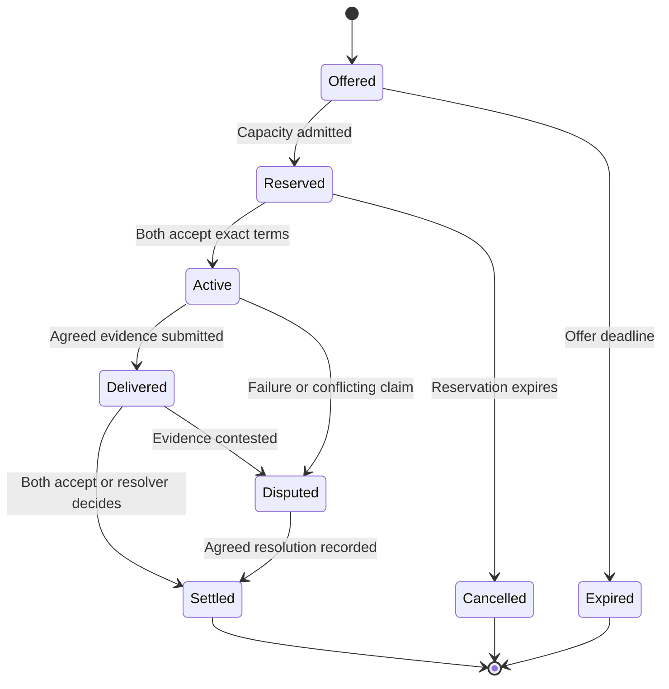

# Example case: distributed trust network of trade

**Status:** proposed architecture and worked scenario, 24 October 2026. Documentation only; no implementation or performance claims.

## 1. Purpose and working assumptions

Tidepool connects nodes that maintain their own operational resources and exchange surplus capacity and resilience. Each node has power, compute, storage, and communications. An agent, potentially an LLM, negotiates within an explicitly authorised operating envelope.

The requirement is scoped self-sufficiency: a node must either cover its essential needs for a declared horizon or disclose the external services it depends on and the limits of those arrangements. An agent's promise is insufficient evidence of capacity or authority.

Proposed starting choices are a small federation of known operators, bilateral service contracts, bounded proof of work at untrusted admission, and resource-specific evidence. These are choices for discussion, not requirements supplied by an existing implementation. If anonymous membership and universally transferable balances are required, the settlement and Sybil-resistance design must be revisited.

## 2. A concrete trade

All three example nodes retain baseline power, compute, storage, and communications. They specialise in what they export:

| Node | Surplus or resilience offered | Needs and dependencies |
| --- | --- | --- |
| A: solar compute node | Deferrable batch computation during an energy surplus | Off-site checkpoint storage; power forecast and battery reserve |
| B: storage node | Encrypted checkpoint retention and retrieval | Occasional compute; storage endurance and a declared power supply |
| C: communications node | A separately reservable mobile uplink when local Wi-Fi fails | Carrier coverage, data allowance, and energy to keep the modem available |

A and B agree to exchange a small, objectively checkable batch job for retention of a 2 GiB encrypted checkpoint for 24 hours. They define chunk sizes, deadlines, verification, and the maximum unpaid service either will deliver. These illustrative quantities are not capacity measurements. C offers a separately priced standby route with a maximum byte allowance; the A–B contract cannot assume C will be available without a reservation.

1. A publishes an expiring offer containing a resource class, time window, location constraints, and service limits. Detailed battery telemetry stays private.
2. B requests a quote. A's controller verifies its remaining budget before reserving the job. B independently reserves storage and retrieval bandwidth.
3. Both sign the same contract digest. It identifies the exact job, dataset digest, checkpoint digest, exchange terms, acceptance criteria, expiry, and dispute process.
4. They deliver in small agreed stages. Both retain signed receipts for accepted stages. Acknowledging receipt of bytes is distinct from accepting the correctness of a result.
5. If clouds reduce A's budget, its controller stops accepting new work and follows the contracted checkpoint or cancellation policy. Work already accepted remains an obligation or a recorded default; a lower forecast does not erase it.
6. If communications fail, each continues only within its already authorised exposure. On reconnection, duplicate receipts have no additional effect and unresolved stages remain pending or disputed.

Stability is itself a service: standby capacity, an independently powered backup, checkpoint recovery, or a diverse communications route can be contracted and tested. A node should not earn credit merely by announcing unused capacity. Related nodes on the same solar/weather, carrier, or hosting dependency do not automatically provide independent redundancy.

Electrical energy can be exchanged only through an actual electrical connection or physical energy transfer. Across the internet, A exports computation powered by its solar supply, not electricity. A physical energy-trading pilot would require a separately specified metering and delivery interface.

## 3. Make self-sufficiency enforceable

Keep the LLM outside the resource enforcement boundary. It can propose trades and interpret requirements, but a deterministic local controller owns reservations, permissions, and resource limits. Give it narrow APIs for quoting, reserving, starting, stopping, and receipting a service.

For a single declared horizon, an illustrative energy budget is:

```text
E_trade_max = max(0,
    E_usable_now + E_generation_conservative
    - E_essential - E_protected_reserve
    - E_already_committed - E_safety_margin)
```

Every term uses the same units and horizon; deductions must not overlap. For example, 1,200 + 400 − 500 − 600 − 200 − 100 leaves 200 Wh for new work. This is a forecast-based admission limit, not proof that future sunshine or delivery is guaranteed. Also enforce instantaneous power, battery discharge, thermal, memory, disk, and network limits: an energy total alone cannot establish feasibility.

Maintain atomic, persistent reservations across all coupled resources. A job may require energy, memory, disk space, and upload capacity at once. An offer is not a reservation. Agent inference, verification, synchronisation, audits, and external model/API charges all count against the node's budget. Cloud-dependent inference must be disclosed and have a fallback; essential controls continue without an LLM.

Use per-agent capabilities with a resource scope, quantity ceiling, permitted counterparties/actions, validity period, and revocation identifier. Keep controller signing keys separate from model-accessible tools. Enforce limits with process isolation and hardware controls where appropriate; signing a policy is not the same as enforcing it. An operator controlling the host can still lie or bypass its software, which is why counterparties need evidence and exposure limits.

## 4. Separate three kinds of assurance

| Mechanism | What it establishes | What it does not establish |
| --- | --- | --- |
| Cryptographic proof of work | A requester expended expected computation on a particular admission request | Unique operator, useful contribution, honest resource accounting, or delivery |
| Evidence of provision | Defined evidence of a particular service, under an explicit verification method | Universal correctness, renewable origin, or future availability |
| Scoped trust | A counterparty is willing to risk a bounded amount for a defined service and period | Global reputation, transferable money, or consensus |

### Bounded admission PoW

Retain PoW as a low-cost admission stamp for unknown peers. The design follows the cost-asymmetry idea of [Hashcash][hashcash], without copying its historical hash algorithm. A possible modern stamp binds a cryptographic hash puzzle to the protocol version, receiver, requester key, request digest, expiry, and receiver challenge.

Verification includes freshness and replay checks. A leading-zero puzzle with difficulty d takes roughly 2^d hashes on average; valid-puzzle checking takes a small fixed number of hashes. Actual solving time is probabilistic. Enforce a local attempt/time/energy cutoff, so a node can stop without finding a solution; never claim a guaranteed solve within a fixed budget.

The receiver also bounds request sizes, verification queues, challenge issuance, retries, and per-peer allocations. Clamp difficulty and the sender's total daily admission budget. Already admitted peers use expiring, quota-limited capabilities. Under attack, shed excess work or pause unknown-peer admission instead of escalating a perpetual mining contest. Reject hostile difficulty demands.

PoW earns no currency, reputation, or voting weight. It is a friction mechanism alongside rate limits and operator admission, not a defence against every well-funded or botnet-backed attacker. If “PoW” instead means evidence of useful work, use the service-specific methods below; arbitrary useful work is not automatically suitable for consensus.

### Evidence depends on the service

| Provision | First-draft evidence | Remaining assumption |
| --- | --- | --- |
| Compute | Task/input/output digests; exact checks for a small deterministic task; selectively repeated computation where affordable | Result hashes alone do not prove correctness; arbitrary LLM output has no assumed cheap universal proof |
| Storage | A committed content digest, unpredictable retrieval challenges, and periodic full restore exercises | Samples give limited evidence at sampled times; do not establish exclusive storage, future durability, or independent replicas |
| Communications | Receiver-confirmed payload digests, byte counts, and timed probes within a stated route/window | Colluding endpoints can invent traffic; a test does not guarantee a future route |
| Power | Calibrated meter readings associated with the physical delivery point, time window, and receiving party | Meter integrity, installation, and physical topology remain trusted assumptions |
| Standby/recovery | Reserved capacity, scheduled failover drills, and measured restoration outcomes | Reserved capacity can still fail, especially under correlated outages |

Audit selection must not be controlled solely by the provider. Charge verification and redundancy costs to the trade. Keep subjective quality evaluation outside automatic credit creation unless a contract explicitly defines an accepted evaluator.

## 5. Trust is a bounded relationship

Represent trust as a policy such as: “B accepts up to two unfinished compute stages from A for this task class until this expiry, using this evidence and dispute procedure.” Track successful and failed obligations by resource, size, time window, and operating conditions. Scheduled sleep outside a promised service window is not a failed obligation.

Use small initial limits, recent direct evidence, expiry, and gradual increases. Third-party attestations name their issuer, evidence, scope, and expiry. A popular identity is not automatically a trusted energy supplier or storage operator.

The pilot admits known operators and records shared control and infrastructure dependencies. Multiple keys do not create independent witnesses or multiply a known operator's allowance. Identity farming and collusive reputation remain threats: cap total local exposure as well as per-peer exposure, and do not mint rewards for circular trades or endorsements. A fresh identity starts with restricted privileges.

The contract specifies who can resolve disputes, what evidence they see, and how cancellations or partial delivery are valued. Suspend disputed exposure rather than silently treating a unilateral receipt as agreement. Model changes do not reset operator history. Key rotation and revocation require an authenticated continuity process; stale credentials receive lower limits or are refused.

## 6. Prevent conflicts without global consensus for every trade

For the pilot, use non-transferable bilateral obligations. There is no universal token, pooled balance, credit routing, or automatic conversion of CPU time, bytes, and Wh. Parties negotiate the exchange rate and keep their own records. Small alternating delivery stages limit losses, but do not provide atomic fair exchange of physical services.

An honest node's transactional reservation store prevents two local agents from allocating the same capacity. This does **not** prevent a malicious operator from selling the same physical capacity twice. Signed promises can expose conflicts when compared; they do not make them impossible. Counterparties manage that remaining risk through admission, independent evidence, and strict exposure caps.

If shared credits or stronger agreement on reservations become necessary, introduce a narrowly scoped settlement domain with an explicitly chosen authority or a mature Byzantine-fault-tolerant replication protocol. [BFT research][bft] supplies a basis for replicated agreement; simply gathering signatures is not a complete consensus protocol. Specify membership, fault bounds, durable locks, state transitions, recovery, and reconfiguration before claiming finality. A domain must serialize overlapping allocations of the same resource and time interval.

Such agreement can stop conflicting accepted ledger claims under its assumptions. It still cannot create missing electricity or prove truthful physical inventory. Keep witness groups independent of the trader and sufficiently diverse in power and connectivity. Their agreement and availability costs must be measured.

During a partition, stop new settlement requiring an unavailable authority or quorum. Offline service can continue only against pre-authorised, bounded obligations; any offline allocation must be disjoint and enforced if it is claimed to prevent reuse. Otherwise accept explicit credit risk. Expiry timestamps and signatures alone do not solve offline double-spending.

Do not bridge balances between settlement domains in the first draft. Later cross-domain transfers need an explicit lock/transfer/redemption protocol and partition behaviour; copying a signed receipt is not a safe transfer. CRDTs or a DAG may help merge observations, but cannot by themselves conserve spendable balances or scarce reservations.

## 7. Keep work proportional to relevant activity

Bitcoin uses accumulated proof of work for its ledger agreement model [bitcoin]. Ethereum has used proof of stake since September 2022 [merge]; its scaling concerns should not be described as current PoW mining. Tidepool's aim is to avoid requiring every node to participate in network-wide ordering, storage, or execution for every small service exchange.

| Scaling risk | Proposed response | Cost or limitation retained |
| --- | --- | --- |
| Mining competition | Admission-only, budgeted PoW; no block rewards | Spam resistance is bounded and uses other admission controls |
| Global execution and ordering | Bilateral contracts; local controllers; optional scoped settlement domains | Weaker guarantees across domains and unknown operators |
| Ever-growing replicated history | Keep active obligations and required evidence locally; archive closed receipts with a retention policy | Historical audits still need the underlying retained data |
| Broadcast and full-mesh traffic | Subscribe by counterparties, resource class, and region; bounded peer sets and replaceable discovery services | Gateways and indexes can become bottlenecks |
| Expensive verification | Cheap checks first, selective audits, batching of non-urgent updates | Sampling misses some faults; batching adds latency |
| Continuous LLM negotiation | Cached templates, fixed contract state machines, limited negotiation rounds; invoke the LLM only when useful | Complex requirements may need operator review |
| Validator or relay concentration | Multiple operators, exportable records, tested replacement paths | Replication has real energy and operating costs |

With T contracts and a bounded k participants/replicas per contract, the design target is O(T × k) ordinary contract-event distribution, rather than O(T × N) distribution to all N nodes. This is a target for bounded contracts, not a measured throughput claim. Discovery, audits, index hot spots, payload size, and any BFT communication are additional costs. Cross-domain demand can defeat locality assumptions.

Checkpoint hashes are compact integrity commitments, not proofs of correct settlement or data availability. Retain the evidence needed for disputes and recovery, with explicit replication and retention. Expire stale offers and aggregate telemetry; avoid global per-second health broadcasts.

## 8. What Bluesky's open source can contribute

**Recommendation: evaluate AT Protocol as the identity, publication, and synchronisation layer. Implement resource authority, contracts, evidence, and settlement separately.** AT Protocol is federated around servers, rather than a ready-made device-to-device mesh [at-overview].

| Component | First-draft use | Boundary |
| --- | --- | --- |
| DIDs and identity libraries | Persistent operator identity and service/key discovery | An identity does not prove one operator, one device, or resource ownership |
| Lexicon and the TypeScript reference implementation | Typed schemas and clients for offers, capabilities, attestations, and receipt references | Schema validity does not establish delivery or authority to spend |
| Personal Data Server (PDS) | Host published records for one or several nodes | A hosted PDS is an explicit dependency and signing-custody decision |
| Signed repositories and content addressing | Verify publication provenance and referenced record integrity | No multi-party atomic commit, guaranteed complete history, or physical truth |
| Tap | Verified repository synchronisation, filtering, recovery, and backfill for selected identities | A separate service to operate; downstream events still need application validation |
| Jetstream | Filtered event discovery and convenient indexing | Treat JSON events as hints; verify authoritative records/proofs before sensitive actions |

The current [TypeScript implementation][at-code] recommends `@atproto/lex` for new applications and includes OAuth, identity, cryptography, and repository packages. The official [PDS distribution][pds-code] provides hosting containers and documentation. These are useful starting components; do not fork the whole Bluesky social application merely to obtain them.

[Tap][tap-code] verifies repository structure and identity signatures, supports selected repositories/collections, and provides at-least-once event delivery with acknowledgements. It is marked beta. Run it within the pilot's trusted infrastructure, persist before acknowledging, and deduplicate application effects. Filtering output does not guarantee the upstream relay ingests only Tidepool traffic; measure that load and avoid full-network mode.

[Jetstream v2][jetstream] supports filtered live consumption and historical replay. Its convenience stream is not a substitute for repository proofs. Discovery can use it while signed contracts and controller authorisation remain the basis for actions. A remote Tap instance is also a trust dependency if clients accept its validation without checking evidence themselves.

Public AT repositories allow deletion without retaining a tombstone [at-repo]. Therefore, keep an application-level receipt archive, counterpart copies, and hashes linking the relevant contractual events; do not assume a fresh repository backfill reconstructs every past obligation. A hash chain makes a retained fork detectable when compared, not globally impossible.

Keep private contracts, precise locations, credentials, workload data, and operational telemetry off the public publication path. The [Spaces alpha][spaces] introduced non-public data, but the [14 October 2026 update][spaces-update] still describes pre-launch development and breaking changes. Evaluate it separately; the initial pilot can use authenticated, encrypted direct channels with access-controlled local storage.

The reference PDS hosting setup expects public DNS and inbound web connectivity [pds-code]. A solar/mobile node behind carrier NAT needs a reachable gateway or another transport arrangement. That gateway, DNS, certificate infrastructure, and identity resolution belong in its dependency model. Use locally authorised short-lived credentials for planned outages, with explicit expiry and revocation-staleness limits.

AT currently supports `did:plc` and `did:web` [at-did]. Choose the directory dependency or domain dependency explicitly; `did:web` is tied to its domain and is not an equivalent recovery/migration mechanism. If a provider controls the repository signing key, use separate locally controlled authorisation for actual resource commitments. A compromised publication service must not gain the ability to spend the node's resources.

## 9. Minimal record and contract model

Use a namespace under a domain the project actually controls. Names below are conceptual record types, not registered Lexicons or implemented schemas.

| Type | Minimum content |
| --- | --- |
| `nodeProfile` | Operator identity, service endpoints, declared dependencies and availability windows |
| `capability` | Issuer/controller, delegated key, actions, resources, ceilings, validity, revocation reference |
| `offer` | Provider, resource/quality class, quantity/unit, location constraint, time window, price basis, expiry |
| `contract` | Unique ID, version, parties, exact terms digest, reservations, evidence method, risk limit, both signatures |
| `receipt` | Contract/stage ID, prior event reference, measured quantity, outcome, evidence digest, signer and signature |
| `attestation` | Subject, issuer, resource scope, observation interval, evidence reference, expiry |
| `dispute` | Contract/stage, contested claims, evidence, agreed resolver and resolution state |

All signed envelopes need a specified canonical encoding, domain separation, schema version, and replay protection. Validate byte limits, integer ranges, resource units, identity/key status, and application-level delegation. Bind signatures to the entire agreed contract and its version, not a free-text summary. Never execute peer-supplied instructions as controller commands.



These are local views of an agreed workflow, not atomic transitions across two machines. One party being Active does not guarantee the other has observed it. Define durable acknowledgements, retransmission, cancellation races, and stage identifiers before implementation. “Settled” means obligations closed under that contract's trust model, not network-wide monetary finality.

## 10. First implementation slice and acceptance checks

Start with three simulated nodes and a single deterministically verifiable compute-for-storage exchange. Use fixed rules before adding an LLM. Implement local budgets, reservations, signed staged receipts, replay handling, and a simulated energy/connectivity schedule. Add a small AT adapter for offers and identity after the trade survives direct operation. The adapter should be replaceable without changing contract semantics.

Next, test on at least two physically independent hosts with metered power and a real constrained link. Public discovery can expand before credit or settlement trust does. BFT settlement, cross-domain credit, anonymous admission at scale, and physical power exchange are later scope decisions.

| Exercise | Required observable outcome |
| --- | --- |
| Concurrent reservations and process restart | Honest controller never exceeds the combined resource/time envelope; restored commitments are retained |
| Low energy or failed forecast | Essential controls stay within reserve policy; new offers stop; existing failures remain visible |
| Malicious or looping LLM | Capability, resource, key-access, and negotiation limits still hold |
| Replayed receipts and stream duplicates | No repeated allocation, service, or credit effect |
| Storage deletion and false compute result | Defined verification detects the injected fault; sampling limitations are reported |
| False capacity or collusive peer claims | Exposure remains within local aggregate limits; false attestations do not mint value |
| Partition and competing promises | No invented global finality; any exposed service stays within the declared risk limit |
| Key revocation and stale identity cache | High-risk operations stop once the allowed staleness expires |
| Relay/PDS outage and record deletion | Directly authorised work and retained evidence remain recoverable within the stated dependency model |
| Growing population and request flood | Per-node bandwidth/CPU/energy remain within budgets or admission sheds load predictably |

Measure joules per accepted contract, verification CPU time, bytes exchanged, persisted bytes per closed contract, negotiation/inference cost, delivery latency, recovery time, and maximum outstanding exposure. Include gateway and archive overhead when evaluating system efficiency. Sweep population and trade locality, and report actual bottlenecks. No numeric performance target is asserted before choosing hardware and service windows.

## 11. Decisions to resolve through the pilot

- Whether PoW is desired strictly as an admission cost or whether “proof” primarily means evidence of useful provision. This draft includes both with different roles.
- Which operator admission and dispute authority are acceptable, and whether anonymous membership is a later requirement.
- What minimum self-sufficiency horizon, essential functions, and reserve rules apply to each node class.
- Which first service can be checked cheaply and objectively; arbitrary LLM quality is a harder starting point.
- Whether settlement must ever create transferable balances, and which additional consistency and trust costs that warrants.
- Whether the intended deployment is internet federation with intermittent edges, a local mesh, or both. AT components help the former; mesh routing and outage transport remain separate work.

## Sources

External implementation facts were checked on 24 October 2026. The proposed Tidepool policies, trade scenario, and architectural boundaries above are design recommendations, not claims that the cited systems implement them.

[at-overview]: https://atproto.com/guides/overview
[at-repo]: https://atproto.com/specs/repository
[at-did]: https://atproto.com/specs/did
[at-code]: https://github.com/bluesky-social/atproto/blob/main/README.md
[pds-code]: https://github.com/bluesky-social/pds/blob/main/README.md
[tap-code]: https://github.com/bluesky-social/indigo/blob/main/cmd/tap/README.md
[jetstream]: https://bsky.network/docs/jetstream/
[spaces]: https://atproto.com/blog/atproto-spaces-alpha
[spaces-update]: https://atproto.com/blog/devex-goals-for-spaces
[hashcash]: https://cdn.nakamotoinstitute.org/docs/hashcash.pdf
[bitcoin]: https://bitcoin.org/bitcoin.pdf
[merge]: https://ethereum.org/roadmap/merge/
[bft]: https://www.usenix.org/conference/osdi-99/practical-byzantine-fault-tolerance

- [AT Protocol overview][at-overview], [repository specification][at-repo], and [DID specification][at-did].
- [Lexicon specification](https://atproto.com/specs/lexicon) and [TypeScript implementation][at-code].
- [PDS distribution][pds-code], [Tap implementation][tap-code], and [Jetstream documentation][jetstream].
- [Spaces alpha announcement][spaces] and [October development update][spaces-update].
- Adam Back, [Hashcash: A Denial of Service Counter-Measure][hashcash] (2002).
- Satoshi Nakamoto, [Bitcoin: A Peer-to-Peer Electronic Cash System][bitcoin] (2008).
- Ethereum documentation, [The Merge][merge].
- Miguel Castro and Barbara Liskov, [Practical Byzantine Fault Tolerance][bft] (1999).
