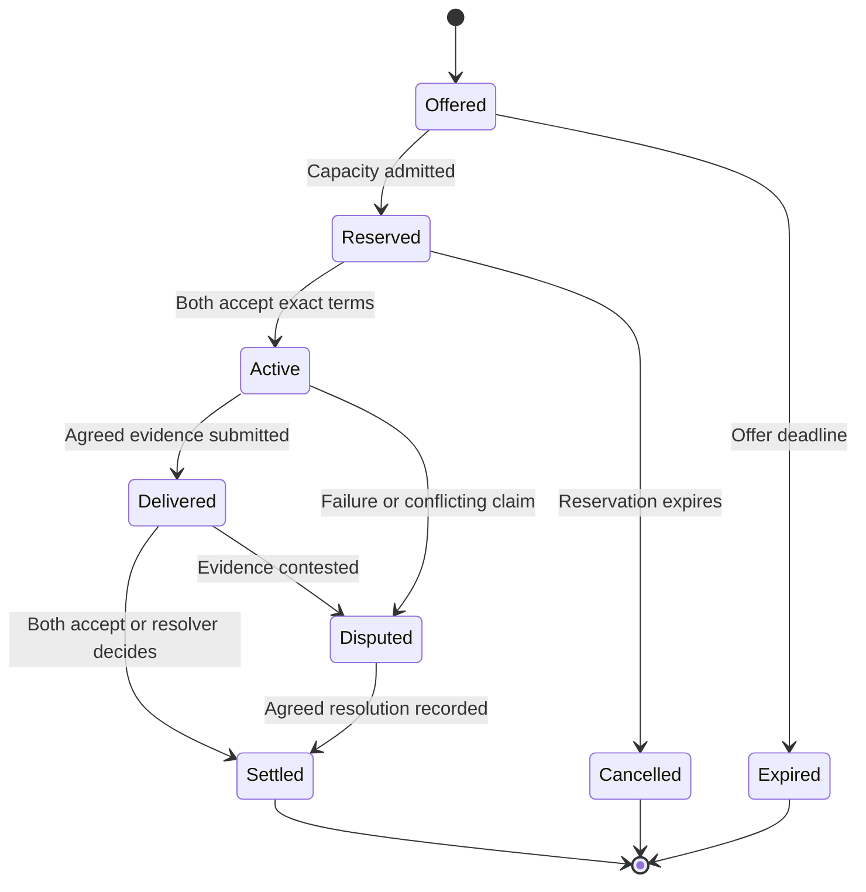

# Example case: distributed trust network of trade

**Status:** proposed architecture and worked scenario, 24 October 2026. Documentation only; no implementation or performance claims.

**Working definition:** “PoW” in this case means useful task completion that others can verify or judge: information delivery, computation, and storage/retrieval. Successful provision can earn payment, reciprocal service, and greater scoped trust. The protocol does not require computational admission puzzles or competitive mining.

## 1. Purpose and working assumptions

Tidepool connects nodes that maintain their own operational resources and exchange surplus capacity and resilience. Each node has power, compute, storage, and communications. An agent, potentially an LLM, negotiates within an explicitly authorised operating envelope.

The requirement is scoped self-sufficiency: a node must either cover its essential needs for a declared horizon or disclose the external services it depends on and the limits of those arrangements. A sponsored newcomer can be provisioned within a funded allowance without claiming to be self-sufficient yet. An agent's promise is insufficient evidence of capacity or authority.

The scenario includes resource-backed participation, independently assessed useful work, and donations or small surplus-funded allowances for new entrants. Proposed implementation choices are a small pilot with known sponsors and verifiers, bilateral contracts, resource-specific evidence, and gradual increases in privileges. Universal transferable balances and unlimited anonymous grants are not assumed; they would require additional settlement and abuse controls.

Broad useful participation and improved network health are goals in their own right. Distribution means useful service coverage, independent operators and failure domains, and tested alternatives. Local hubs may improve efficiency without receiving control of every identity, payment, or protocol change. See the [network-health toy model](network-health-toy-model.md).

## 2. A concrete trade

All three example nodes retain baseline power, compute, storage, and communications. They specialise in what they export:

| Node | Surplus or resilience offered | Needs and dependencies |
| --- | --- | --- |
| A: solar compute node | Deferrable batch computation during an energy surplus | Off-site checkpoint storage; power forecast and battery reserve |
| B: storage node | Encrypted checkpoint retention and retrieval | Occasional compute; storage endurance and a declared power supply |
| C: communications node | A separately reservable mobile uplink when local Wi-Fi fails | Carrier coverage, data allowance, and energy to keep the modem available |

A and B agree to exchange a small, objectively checkable batch job for retention of a 2 GiB encrypted checkpoint for 24 hours. They define chunk sizes, deadlines, verification, and the maximum unpaid service either will deliver. These illustrative quantities are not capacity measurements. C offers a separately priced standby route with a maximum byte allowance; the A–B contract cannot assume C will be available without a reservation.

1. A publishes an expiring offer containing a resource class, time window, location constraints, and service limits. Detailed battery telemetry stays private.
2. B requests a quote. A's controller verifies its remaining budget before reserving the job. B independently reserves storage and retrieval bandwidth.
3. Both sign the same contract digest. It identifies the exact job, dataset digest, checkpoint digest, exchange terms, acceptance criteria, expiry, and dispute process.
4. They deliver in small agreed stages. Both retain signed receipts for accepted stages, including the verification method and any independent evaluator. Acknowledging receipt of bytes is distinct from accepting the correctness of a result. These verified stages are the example's “PoW”.
5. If clouds reduce A's budget, its controller stops accepting new work and follows the contracted checkpoint or cancellation policy. Work already accepted remains an obligation or a recorded default; a lower forecast does not erase it.
6. If communications fail, each continues only within its already authorised exposure. On reconnection, duplicate receipts have no additional effect and unresolved stages remain pending or disputed.

Stability is itself a service: standby capacity, an independently powered backup, checkpoint recovery, or a diverse communications route can be contracted and tested. A node should not earn credit merely by announcing unused capacity. Related nodes on the same solar/weather, carrier, or hosting dependency do not automatically provide independent redundancy.

Power is primarily an operating input to the compute, storage, and networking being sold. Accepted services can earn reciprocal provisions or payments that help fund batteries, drives, radios, replacement hardware, and maintenance. Hardware procurement requires an actual funded purchase or a supplier accepting the agreed barter; a service receipt alone cannot guarantee redemption for a device. Direct electricity trading is outside the first draft.

## 3. Make self-sufficiency enforceable

Keep the LLM outside the resource enforcement boundary. It can propose trades and interpret requirements, but a deterministic local controller owns reservations, permissions, and resource limits. Give it narrow APIs for quoting, reserving, starting, stopping, and receipting a service.

For a single declared horizon, an illustrative energy budget is:

```text
E_trade_max = max(0,
    E_usable_now + E_generation_conservative
    - E_essential - E_protected_reserve
    - E_already_committed - E_safety_margin)
```

Every term uses the same units and horizon; deductions must not overlap. For example, 1,200 + 400 − 500 − 600 − 200 − 100 leaves 200 Wh for new work. This is a forecast-based admission limit, not proof that future sunshine or delivery is guaranteed. Also enforce instantaneous power, battery discharge, thermal, memory, disk, and network limits: an energy total alone cannot establish feasibility.

Maintain atomic, persistent reservations across all coupled resources. A job may require energy, memory, disk space, and upload capacity at once. An offer is not a reservation. Agent inference, verification, synchronisation, audits, and external model/API charges all count against the node's budget. Cloud-dependent inference must be disclosed and have a fallback; essential controls continue without an LLM.

Use per-agent capabilities with a resource scope, quantity ceiling, permitted counterparties/actions, validity period, and revocation identifier. Keep controller signing keys separate from model-accessible tools. Enforce limits with process isolation and hardware controls where appropriate; signing a policy is not the same as enforcing it. An operator controlling the host can still lie or bypass its software, which is why counterparties need evidence and exposure limits.

## 4. Proof of useful task completion

Separate authenticity, correctness, and value. A signature identifies who made a claim. A verification method checks a specified property of the service. An authorised customer or sponsor decides whether that service was wanted and what to pay for it. None of these three automatically supplies the others.

| Provision | First-draft evidence | Boundary of the claim |
| --- | --- | --- |
| Information delivery | Sender commits a payload digest and task ID; destination returns an authenticated acknowledgement binding those bytes, a fresh challenge, and the delivery window | Establishes delivery to that destination under its honesty assumption; does not alone prove a particular route or independent ownership of endpoints |
| Compute | Bind program/version, inputs, parameters, and output; use an independently known answer, a task-specific verifier, or independent recomputation | A checksum alone cannot establish that the output solves the requested task |
| Storage | Commit actual requested content, challenge unpredictable chunks with integrity proofs, and periodically exercise full retrieval | Basic samples show access to sampled data; they do not establish all future availability, unique physical replicas, or location |
| Standby/recovery | Reserve capacity and observe failover/restoration drills in the promised windows | Measured performance remains conditional on workload and failure environment |
| Hardware provision | Recipient confirms delivery, installation, and agreed acceptance tests against a funded procurement order | Physical possession, ownership, and device independence need evidence beyond a digital signature |

### Delivery: verify an actual requested transfer

Bind receipts to a contract, stage, content digest, sender, destination, unique nonce, and applicable deadline. A fresh challenge should be authenticated and cannot be reused to claim multiple deliveries. For store-and-forward work, intermediate custody receipts help diagnose failures, while the destination's receipt establishes completion under the contract. A latency claim needs a specified measuring endpoint and clock assumptions; an untrusted timestamp is insufficient.

Two parties controlled by one operator can exchange real bytes and issue valid receipts to each other. That does not establish external usefulness or justify a common subsidy. Require an authorised, budgeted request and an accepted beneficiary/verifier for funded rewards. Avoid paying for extra hops or unrequested traffic: a longer route is not automatically more valuable. If a specific path matters, its observation and attestation are a separate requirement.

### Compute: what checksums and independent checks can establish

A cryptographic digest is a commitment to particular bytes. Comparing it to an independently established expected digest can validate those bytes, subject to the hash assumptions. Comparing only worker-supplied digests establishes agreement, which could be agreement on an incorrect result. An ordinary checksum designed for accidental corruption is not an adversarial correctness proof.

There are three useful verification classes:

1. **Cheap objective verification.** Some task relations can be checked much more cheaply than recomputing the answer. For example, Freivalds-style matrix-product verification uses random matrix-vector checks [freivalds]. For an exact finite-field task with one claimed result fixed before fresh independent random challenges, k repetitions give an incorrect fixed result a false-acceptance probability at most 2^-k, with O(k × n²) verification arithmetic. That bound is not a guarantee for arbitrary floating-point or LLM computations. Choose the actual verifier, encoding, and workload before claiming a saving.
2. **Independent recomputation or audits.** Assign replicas or selected subtasks to independently controlled eligible verifiers, prevent copying with commitments before reveals, and compare defined outputs. Disagreements trigger a specified resolver or fresh check. Matching results still depend on verifier independence and the absence of shared bugs; multiple identities are not multiple operators. Publish the audit method and its limits, rather than calling a majority vote a mathematical proof.
3. **Judged work.** For open-ended LLM output, use an agreed rubric, evidence, and named evaluators or customer acceptance. Record disagreements and quality separately from mechanically verified completion. A judging LLM is also a fallible evaluator.

A sound mathematical verifier can reject a single dishonest provider's false result without assuming that provider finds honesty profitable. Distributed checking helps only with its stated trust and fault assumptions. It does not remove incentive problems in task demand, verifier selection, payment, collusion, or grants. Caching or subcontracting a correct result can be acceptable when the contract buys the result; if it buys work on a specific device or prohibits outsourcing, add a separate provenance requirement.

### Storage: challenge the customer's data

Use a versioned digest or Merkle root for the actual stored content, with fresh challenge selection outside the provider's control, response windows, and retained receipts. Periodic full restores test whether the client can recover its data at the promised throughput. A sampled chunk proof verifies membership in the committed content, not a unique disk or independent failure domain. A provider might fetch chunks from another provider quickly enough to answer; tight deadlines alone do not eliminate this possibility.

For intuition only, if a fixed fraction q of chunks is missing and m indices are independently sampled uniformly with replacement, the probability of seeing no missing chunk is (1 − q)^m. This model assumes fresh unpredictable samples, that missing data cannot be fetched or reconstructed in time, and that missingness is fixed for the test. It is not a proof of ongoing storage or full recoverability. Even zero audit failures must be reported with sample count and assumptions.

Chia is a useful analogy for challenge/response, but its proof-of-space plots contain protocol-generated data rather than the customer's files [chia-data]. Proofs of retrievability are a closer research starting point for proving recovery of outsourced content under formal assumptions [por]. Filecoin's replication and spacetime proofs provide additional design references, with their own computational and protocol costs [filecoin-proofs]. The first pilot need not adopt either blockchain or its reward model. A simple challenge sampler must not be labelled a formal proof-of-retrievability implementation.

Test independent recovery across agreed failure domains. Erasure coding may reduce replication cost, but introduces a recovery threshold, repair traffic, and placement assumptions. Several responsive identities on one disk do not satisfy an independent-redundancy promise.

### Choose verifiers and keep checks affordable

Each contract specifies the verification class, eligible verifiers, selection method, evidence, acceptance threshold, dispute handling, and budget. Neither worker nor requester may unilaterally designate all evaluators for a claim against shared funds. Start with known independently controlled verifiers; randomly rotating among Sybil identities would not solve independence. New entrants can perform work before gaining authority to approve shared payments.

Prefer cheap objective verifiers, then selective audits and replication proportionate to risk. Bound audit load and avoid everybody checking every task. Common implementation errors may require a different implementation or known-answer controls; three copies of one faulty verifier are insufficient. Record useful output, audit cost, and confidence separately. Pay for commissioned work accepted under its contract, not merely for passing self-generated tests. Basic admission uses quotas, bounded queues, and funded capabilities.

## 5. Trust is a bounded relationship

Represent trust as a policy such as: “B accepts up to two unfinished compute stages from A for this task class until this expiry, using this evidence and dispute procedure.” Track successful and failed obligations by resource, size, time window, and operating conditions. Scheduled sleep outside a promised service window is not a failed obligation.

Use small initial limits, recent direct evidence, expiry, and gradual increases. Third-party attestations name their issuer, evidence, scope, and expiry. A popular identity is not automatically a trusted energy supplier or storage operator.

The pilot starts with known sponsors and verifiers, and admits newcomers to bounded service trials. Record known shared control and infrastructure dependencies. Multiple keys do not create independent witnesses or multiply a known operator's allowance. Unknown duplicate operators may remain undetectable: cap total local exposure and the total grant pool as well as per-peer exposure. Circular trades or endorsements do not by themselves establish useful contribution. A fresh identity starts with restricted privileges.

The contract specifies who can resolve disputes, what evidence they see, and how cancellations or partial delivery are valued. Suspend disputed exposure rather than silently treating a unilateral receipt as agreement. Model changes do not reset operator history. Key rotation and revocation require an authenticated continuity process; stale credentials receive lower limits or are refused.

### Local preference and acceptance outside the local group

Participants may prefer familiar peers, give favourable terms, exchange gifts, or operate a local reciprocal economy. Locality, friendship, repeated trade, or choosing a trusted hub is not itself misconduct. Local trust can authorise use of the parties' own resources without creating a claim on anyone else's resources.

Hub-and-spoke topology does not prevent fabricated or circular exchanges. A hub can help retain evidence, detect duplicate claims, enforce its own quotas, and organise checks. However, a colluding hub can endorse false claims, and two apparently separate hubs may share control. Multiple network identities cannot simply be counted as independent parties; this is the [Sybil problem][sybil]. Routing structure and trust policy are distinct.

There is no automatic conversion from local endorsement into universal reputation, shared-fund eligibility, or voting authority. Each receiving counterparty or funding domain applies its own acceptance policy. Carry evidence with its issuer, task, beneficiary, scope, verification method, known affiliations, and expiry. Preserve the original evidence when relaying an attestation; additional hub signatures do not manufacture additional independent observations. Do not infer common ownership solely from geography, friendship, or an IP address.

For example, A and B may perform 10,000 transfers through their preferred hub. They may genuinely deliver those bytes and choose to pay each other, but the volume does not by itself demonstrate 10,000 independent customers or justify a common subsidy. Before drawing on shared funds, a task needs authorised demand, an available budget, and acceptance under the fund's verification policy. Correctness checks alone do not prove demand or beneficiary independence. External verification must be independent of the claimants, or establish the relevant objective property through a sound verifier; it must not merely repeat the hub's assertion. Any additional independence requirement for funding still applies.

Local work can nevertheless produce evidence that outsiders independently verify and accept. A valid computation proof or an externally observed retrieval remains useful evidence regardless of where the task originated, within its precise scope. Unknown external trust is not a penalty or a finding of fraud. Restricting access to shared funds for insufficient evidence is different from punishing local preference; consequences for fabrication or contractual failure must follow the agreed policy and dispute process.

### Surplus-funded entry and gradual trust

“Buy in” can be contributed hardware capacity, a small service successfully delivered, an agreed deposit, or a sponsor-funded trial. Cash purchase is not a mandatory entry requirement. Donated capacity is an explicit grant with a resource type, maximum quantity, eligible tasks, recipient, expiry, and named issuer; it does not create an unrestricted transferable balance.

1. A sponsor reserves a newcomer pool after essential operation, existing obligations, repair needs, and safety margins. Bound compute, storage, bandwidth, and audit expenditure separately; plentiful CPU time does not make mobile data free.
2. A newcomer receives a small expiring allowance to execute a real sponsored task or a clearly labelled onboarding test. The issuer tracks spent and outstanding grants atomically against its funded pool. A grant valid at several nodes needs shared accounting or disjoint preallocated quotas.
3. Independent checks record accepted results, failures, resource use, and the subsidy consumed. Passing an onboarding test can establish limited capability without being counted as paid external demand.
4. Increase access gradually after repeated relevant successes. Cap concurrent grants and unsettled obligations; a good history at small task sizes does not justify an unlimited large task. A donation can remain a gift without a repayment obligation, while expanded trading privileges depend on evidence.
5. Renew only within available funding and capacity. During a shortage, stop issuing new grants and apply the declared service priorities; do not silently revoke already promised commitments.

Large surplus makes generosity affordable but does not create unique identities. Unlimited “one free allocation per new key” can be drained by one operator. A fixed aggregate allowance limits the loss even when identities are cheap; sponsorship, paced intake, task assignment, and per-beneficiary restrictions improve allocation. They do not guarantee every genuine newcomer fair access under unlimited Sybil attack. Do not depend on IP addresses or hardware identifiers as perfect uniqueness proofs.

Compare newcomers and established nodes on comparable task classes, sizes, operating windows, latency, availability, accepted quality, and net resource cost. Include sample counts, uncertainty, and recent failures. Long history supplies more evidence, not immunity from audits; low sample count calls for limited exposure, not a presumption of dishonesty. Known-answer tests and operator-independent observations help avoid circular reputation growth.

### From useful service to hardware provision

The economic loop is: commissioned service, accepted evidence, agreed payment or reciprocal service, then maintenance and capacity expansion. Reserve part of realised proceeds or explicit donations for hardware replacement and newcomer support. A supplier must actually accept the payment medium or barter obligation, and procurement requires a funded budget, authorised buyer, and delivery acceptance.

Evaluate whether the accepted service covers energy, communication charges, wear, verification, redundancy, and maintenance, or whether a sponsor intentionally covers the gap. Track these in their actual resource units or an explicitly agreed valuation; bytes and CPU time are not inherently interchangeable. Distinguish external customer income, reciprocal exchange, and donations. Correctly performing a task does not prove market demand or create purchasing power automatically, and planned donations need not be justified by immediate profit.

## 6. Prevent conflicts without global consensus for every trade

For the pilot, use non-transferable bilateral obligations. There is no universal token, pooled balance, credit routing, or automatic conversion of CPU time, bytes, and Wh. Parties negotiate the exchange rate and keep their own records. Small alternating delivery stages limit losses, but do not provide atomic fair exchange of physical services.

An honest node's transactional reservation store prevents two local agents from allocating the same capacity. This does **not** prevent a malicious operator from selling the same physical capacity twice. Signed promises can expose conflicts when compared; they do not make them impossible. Counterparties manage that remaining risk through admission, independent evidence, and strict exposure caps.

If shared credits or stronger agreement on reservations become necessary, introduce a narrowly scoped settlement domain with an explicitly chosen authority or a mature Byzantine-fault-tolerant replication protocol. [BFT research][bft] supplies a basis for replicated agreement; simply gathering signatures is not a complete consensus protocol. Specify membership, fault bounds, durable locks, state transitions, recovery, and reconfiguration before claiming finality. A domain must serialize overlapping allocations of the same resource and time interval.

Such agreement can stop conflicting accepted ledger claims under its assumptions. It still cannot create missing electricity or prove truthful physical inventory. Keep witness groups independent of the trader and sufficiently diverse in power and connectivity. Their agreement and availability costs must be measured.

During a partition, stop new settlement requiring an unavailable authority or quorum. Offline service can continue only against pre-authorised, bounded obligations; any offline allocation must be disjoint and enforced if it is claimed to prevent reuse. Otherwise accept explicit credit risk. Expiry timestamps and signatures alone do not solve offline double-spending.

Do not bridge balances between settlement domains in the first draft. Later cross-domain transfers need an explicit lock/transfer/redemption protocol and partition behaviour; copying a signed receipt is not a safe transfer. CRDTs or a DAG may help merge observations, but cannot by themselves conserve spendable balances or scarce reservations.

## 7. Keep work proportional to relevant activity

Bitcoin uses accumulated proof of work for its ledger agreement model [bitcoin]. Ethereum has used proof of stake since September 2022 [merge]; its scaling concerns should not be described as current PoW mining. Tidepool's aim is to avoid requiring every node to participate in network-wide ordering, storage, or execution for every small service exchange.

| Scaling risk | Proposed response | Cost or limitation retained |
| --- | --- | --- |
| Unproductive work and reward inflation | Authorised demand, useful completion checks, and payments from agreed budgets; no rewards merely for producing proofs | Verification cannot establish demand or customer independence by itself |
| Global execution and ordering | Bilateral contracts; local controllers; optional scoped settlement domains | Weaker guarantees across domains and unknown operators |
| Ever-growing replicated history | Keep active obligations and required evidence locally; archive closed receipts with a retention policy | Historical audits still need the underlying retained data |
| Broadcast and full-mesh traffic | Subscribe by counterparties, resource class, and region; bounded peer sets and replaceable discovery services | Gateways and indexes can become bottlenecks |
| Expensive verification | Cheap checks first, selective audits, batching of non-urgent updates | Sampling misses some faults; batching adds latency |
| Continuous LLM negotiation | Cached templates, fixed contract state machines, limited negotiation rounds; invoke the LLM only when useful | Complex requirements may need operator review |
| Validator or relay concentration | Multiple operators, exportable records, tested replacement paths | Replication has real energy and operating costs |
| Excessive replicated checking | Task-specific cheap verifiers and a bounded audit/replica budget | Audit confidence and verifier independence must be stated |

With T contracts and a bounded k participants/replicas per contract, the design target is O(T × k) ordinary contract-event distribution, rather than O(T × N) distribution to all N nodes. This is a target for bounded contracts, not a measured throughput claim. Discovery, audits, index hot spots, payload size, and any BFT communication are additional costs. Cross-domain demand can defeat locality assumptions.

Checkpoint hashes are compact integrity commitments, not proofs of correct settlement or data availability. Retain the evidence needed for disputes and recovery, with explicit replication and retention. Expire stale offers and aggregate telemetry; avoid global per-second health broadcasts.

### Distribution, adaptation, and network improvement

Reward requested completed service and explicitly commissioned resilience or coverage. A newcomer providing an independent route to an underserved area may be more useful than an extra high-capacity provider behind an existing bottleneck. Spreading identical identities across the same infrastructure does not automatically increase resilience. Availability contracts can pay for tested standby capacity even when it carries little ordinary traffic; fund these as a deliberate public-good expense rather than expecting volume-based fees to supply every needed backup.

Use local hub-and-spoke clusters where bandwidth and geography favour them, with bounded lateral connections, alternative gateways, and replicated critical state across independent domains. Separate a routing hub from identity authority, storage placement, shared-fund approval, and verifier selection. Hardware dependencies such as a shared carrier can defeat apparent graph diversity.

Adapt task placement, congestion limits, batching, repair bandwidth, standby reservations, and newcomer allowances to observed capacity and reserves. Use smoothing, separate activation/deactivation thresholds, limited adjustment rates, and cooldowns to prevent oscillation. Immediate failure responses and hard resource limits remain separate from slower optimisation. Preserve minimum correctness checks and existing commitments under load; reduce admission instead of silently weakening verification. The [toy model](network-health-toy-model.md) illustrates capacity and hub failures; it does not implement this controller.

Network health work is a service class: replication repair, alternative-route deployment, diagnostics, reproducible benchmarks, protocol implementations, interoperability tests, and reviewed fixes can all be commissioned. Define a baseline, desired change, acceptance evidence, budget, and independent evaluator. A patch count, self-reported improvement, or self-created fault is insufficient. Protocol changes require versioned proposals, compatibility/security tests, staged rollout, consent of the relevant operators, and rollback; service reputation does not grant unilateral authority to change the rules or payments.

## 8. What Bluesky's open source can contribute

**Recommendation: evaluate AT Protocol as the identity, publication, and synchronisation layer. Implement resource authority, contracts, evidence, and settlement separately.** AT Protocol is federated around servers, rather than a ready-made device-to-device mesh [at-overview].

| Component | First-draft use | Boundary |
| --- | --- | --- |
| DIDs and identity libraries | Persistent operator identity and service/key discovery | An identity does not prove one operator, one device, or resource ownership |
| Lexicon and the TypeScript reference implementation | Typed schemas and clients for offers, capabilities, attestations, and receipt references | Schema validity does not establish delivery or authority to spend |
| Personal Data Server (PDS) | Host published records for one or several nodes | A hosted PDS is an explicit dependency and signing-custody decision |
| Signed repositories and content addressing | Verify publication provenance and referenced record integrity | No multi-party atomic commit, guaranteed complete history, or physical truth |
| Tap | Verified repository synchronisation, filtering, recovery, and backfill for selected identities | A separate service to operate; downstream events still need application validation |
| Jetstream | Filtered event discovery and convenient indexing | Treat JSON events as hints; verify authoritative records/proofs before sensitive actions |

The current [TypeScript implementation][at-code] recommends `@atproto/lex` for new applications and includes OAuth, identity, cryptography, and repository packages. The official [PDS distribution][pds-code] provides hosting containers and documentation. These are useful starting components; do not fork the whole Bluesky social application merely to obtain them.

[Tap][tap-code] verifies repository structure and identity signatures, supports selected repositories/collections, and provides at-least-once event delivery with acknowledgements. It is marked beta. Run it within the pilot's trusted infrastructure, persist before acknowledging, and deduplicate application effects. Filtering output does not guarantee the upstream relay ingests only Tidepool traffic; measure that load and avoid full-network mode.

[Jetstream v2][jetstream] supports filtered live consumption and historical replay. Its convenience stream is not a substitute for repository proofs. Discovery can use it while signed contracts and controller authorisation remain the basis for actions. A remote Tap instance is also a trust dependency if clients accept its validation without checking evidence themselves.

Public AT repositories allow deletion without retaining a tombstone [at-repo]. Therefore, keep an application-level receipt archive, counterpart copies, and hashes linking the relevant contractual events; do not assume a fresh repository backfill reconstructs every past obligation. A hash chain makes a retained fork detectable when compared, not globally impossible.

Keep private contracts, precise locations, credentials, workload data, and operational telemetry off the public publication path. The [Spaces alpha][spaces] introduced non-public data, but the [14 October 2026 update][spaces-update] still describes pre-launch development and breaking changes. Evaluate it separately; the initial pilot can use authenticated, encrypted direct channels with access-controlled local storage.

The reference PDS hosting setup expects public DNS and inbound web connectivity [pds-code]. A solar/mobile node behind carrier NAT needs a reachable gateway or another transport arrangement. That gateway, DNS, certificate infrastructure, and identity resolution belong in its dependency model. Use locally authorised short-lived credentials for planned outages, with explicit expiry and revocation-staleness limits.

AT currently supports `did:plc` and `did:web` [at-did]. Choose the directory dependency or domain dependency explicitly; `did:web` is tied to its domain and is not an equivalent recovery/migration mechanism. If a provider controls the repository signing key, use separate locally controlled authorisation for actual resource commitments. A compromised publication service must not gain the ability to spend the node's resources.

## 9. Minimal record and contract model

Use a namespace under a domain the project actually controls. Names below are conceptual record types, not registered Lexicons or implemented schemas.

| Type | Minimum content |
| --- | --- |
| `nodeProfile` | Operator identity, service endpoints, declared dependencies and availability windows |
| `capability` | Issuer/controller, delegated key, actions, resources, ceilings, validity, revocation reference |
| `offer` | Provider, resource/quality class, quantity/unit, location constraint, time window, price basis, expiry |
| `contract` | Unique ID, version, parties/beneficiary, exact terms digest, reservations, verification class and evaluator policy, funding authority, risk limit, both signatures |
| `receipt` | Contract/stage ID, prior event reference, measured quantity, outcome, evidence digest, verification method/challenge, evaluator, signer and signature |
| `attestation` | Subject, issuer, resource scope, observation interval, evidence reference, expiry |
| `dispute` | Contract/stage, contested claims, evidence, agreed resolver and resolution state |
| `trialAllowance` | Issuer and recipient, funded pool/reservation ID, resource type, maximum quantity, permitted tasks, expiry, remaining allowance and redemption authority |
| `improvementTask` | Sponsor, affected service/protocol version, baseline, desired measurable outcome, budget, independent acceptance method, rollout/rollback plan |

All signed envelopes need a specified canonical encoding, domain separation, schema version, and replay protection. Validate byte limits, integer ranges, resource units, identity/key status, and application-level delegation. Bind signatures to the entire agreed contract and its version, not a free-text summary. Never execute peer-supplied instructions as controller commands.



These are local views of an agreed workflow, not atomic transitions across two machines. One party being Active does not guarantee the other has observed it. Define durable acknowledgements, retransmission, cancellation races, and stage identifiers before implementation. “Settled” means obligations closed under that contract's trust model, not network-wide monetary finality.

## 10. First implementation slice and acceptance checks

Start with three simulated nodes and a single objectively verifiable compute-for-storage exchange. Add a separately controlled verifier role and one newcomer role funded by an existing node's capped donation pool; roles may share a simulator but must not be claimed as independently operated hardware. Use fixed rules before adding an LLM. Implement local budgets, reservations, signed staged receipts, replay handling, useful-work checks, and a simulated energy/connectivity schedule. Add a small AT adapter for offers and identity after the trade survives direct operation. The adapter should be replaceable without changing contract semantics.

Next, test on physically independent hosts with separately controlled verification, metered operating power, and a real constrained link. Public discovery and capped newcomer trials can expand before shared settlement trust does. BFT settlement, cross-domain credit, large-scale anonymous grants, and actual hardware procurement are later scope decisions.

| Exercise | Required observable outcome |
| --- | --- |
| Concurrent reservations and process restart | Honest controller never exceeds the combined resource/time envelope; restored commitments are retained |
| Low energy or failed forecast | Essential controls stay within reserve policy; new offers stop; existing failures remain visible |
| Malicious or looping LLM | Capability, resource, key-access, and negotiation limits still hold |
| Replayed receipts and stream duplicates | No repeated allocation, service, or credit effect |
| Storage deletion and false compute result | Defined verification detects the injected fault; sampling limitations are reported |
| False capacity or collusive peer claims | Exposure remains within local aggregate limits; false attestations do not mint value |
| Circular local trades endorsed by one or several hubs | Local preferences remain permitted; endorsement chains and transaction counts cannot automatically raise shared-fund eligibility or independent-observer counts |
| Matching hashes of an incorrect result | Digest agreement is not accepted as correctness; the independent acceptance predicate is exercised |
| Replayed delivery or self-generated traffic | No duplicate payment; uncommissioned traffic cannot draw from the common budget |
| Shared storage behind several identities | Availability results do not count as demonstrated independent replicas |
| Many newcomer identities or concurrent redemptions | Spent plus outstanding grants never exceed the funded pool; report genuine entrants displaced by abuse |
| Successful and failed newcomer trials | Comparable evidence drives bounded access changes; donations and external earnings remain distinguishable |
| Partition and competing promises | No invented global finality; any exposed service stays within the declared risk limit |
| Key revocation and stale identity cache | High-risk operations stop once the allowed staleness expires |
| Relay/PDS outage and record deletion | Directly authorised work and retained evidence remain recoverable within the stated dependency model |
| Growing population and request flood | Per-node bandwidth/CPU/energy remain within budgets or admission sheds load predictably |
| Hub loss and shared-carrier failure | Tested alternatives meet the declared degraded service floor; correlated failures are counted |
| Noisy demand and adaptive routing | Bounded control changes do not repeatedly move the same workload or violate reservations |
| Claimed protocol or health improvement | Independent before/after tests meet the commissioned objective; incompatible changes cannot silently activate |

Measure joules per accepted contract, verification CPU time, bytes exchanged, persisted bytes per closed contract, negotiation/inference cost, delivery latency, recovery time, and maximum outstanding exposure. Track audit false-acceptance/false-rejection results, verifier independence, grant consumption, accepted newcomer contribution, and ongoing subsidy. Include gateway, repair, archive, and validation overhead when evaluating system efficiency. Sweep population and trade locality, and report actual bottlenecks. No numeric performance target is asserted before choosing hardware and service windows.

## 11. Decisions to resolve through the pilot

- Which objective verification method and independent evaluator policy the first task uses, including its false-acceptance assumptions and audit cost.
- Which sponsor, verifier, and dispute authority are acceptable, and how open entry can grow while shared spending authority remains bounded.
- How much surplus is donated, which resource limits apply, and how trial results lead to larger allowances without rewarding identity churn.
- How hardware procurement is funded and accepted, and which counterparties will accept service barter or payment.
- Which coverage, independent recovery, and participation goals justify explicit funding alongside throughput and operating cost.
- Which operational parameters may adapt locally, and how protocol changes are reviewed, versioned, and rolled back.
- What minimum self-sufficiency horizon, essential functions, and reserve rules apply to each node class.
- Which first service can be checked cheaply and objectively; arbitrary LLM quality is a harder starting point.
- Whether settlement must ever create transferable balances, and which additional consistency and trust costs that warrants.
- Whether the intended deployment is internet federation with intermittent edges, a local mesh, or both. AT components help the former; mesh routing and outage transport remain separate work.

## Sources

External implementation facts were checked on 24 October 2026. The proposed Tidepool policies, trade scenario, and architectural boundaries above are design recommendations, not claims that the cited systems implement them.

[at-overview]: https://atproto.com/guides/overview
[at-repo]: https://atproto.com/specs/repository
[at-did]: https://atproto.com/specs/did
[at-code]: https://github.com/bluesky-social/atproto/blob/main/README.md
[pds-code]: https://github.com/bluesky-social/pds/blob/main/README.md
[tap-code]: https://github.com/bluesky-social/indigo/blob/main/cmd/tap/README.md
[jetstream]: https://bsky.network/docs/jetstream/
[spaces]: https://atproto.com/blog/atproto-spaces-alpha
[spaces-update]: https://atproto.com/blog/devex-goals-for-spaces
[chia-data]: https://www.chia.net/blog/why-chia-plots-dont-contain-real-user-data/
[por]: https://eprint.iacr.org/2008/073
[freivalds]: https://arxiv.org/abs/0912.3925
[filecoin-proofs]: https://spec.filecoin.io/algorithms/pos/
[bitcoin]: https://bitcoin.org/bitcoin.pdf
[merge]: https://ethereum.org/roadmap/merge/
[bft]: https://www.usenix.org/conference/osdi-99/practical-byzantine-fault-tolerance
[sybil]: https://www.microsoft.com/en-us/research/publication/the-sybil-attack/

- [AT Protocol overview][at-overview], [repository specification][at-repo], and [DID specification][at-did].
- [Lexicon specification](https://atproto.com/specs/lexicon) and [TypeScript implementation][at-code].
- [PDS distribution][pds-code], [Tap implementation][tap-code], and [Jetstream documentation][jetstream].
- [Spaces alpha announcement][spaces] and [October development update][spaces-update].
- Chia Network, [Why Chia Plots Don't Contain Real User Data][chia-data] (2024).
- Hovav Shacham and Brent Waters, [Compact Proofs of Retrievability][por] (2008).
- Vamsi K. Kundeti, [A Simplified Proof For The Application Of Freivalds' Technique to Verify Matrix Multiplication][freivalds] (2009).
- Filecoin specification, [Proof-of-Storage][filecoin-proofs].
- Satoshi Nakamoto, [Bitcoin: A Peer-to-Peer Electronic Cash System][bitcoin] (2008).
- Ethereum documentation, [The Merge][merge].
- Miguel Castro and Barbara Liskov, [Practical Byzantine Fault Tolerance][bft] (1999).
- John R. Douceur, [The Sybil Attack][sybil] (2002).
