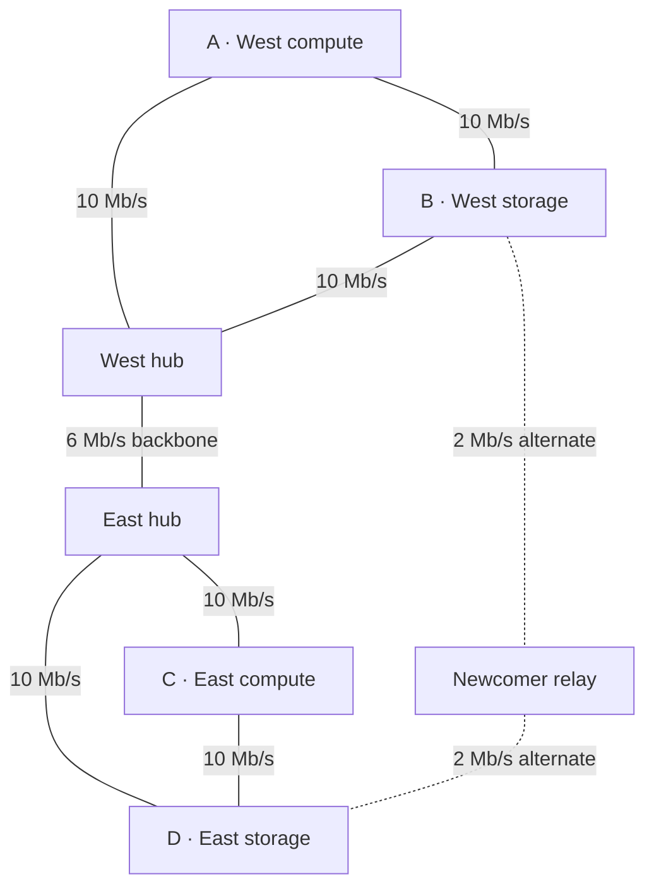

# Network health and adaptive topology: a toy model

**Status:** illustrative design model, 24 October 2026. This extends the [distributed trade case](distributed-trust-network-of-trade.md). Capacities are invented for discussion and are not measurements or performance forecasts.

## Goal: useful distribution with efficient local hubs

Tidepool should encourage service coverage, participation by independently controlled operators, recoverable data, and viable alternative routes. Equal rewards per identity would not establish any of those properties. Reward commissioned services and fund coverage or resilience explicitly when ordinary traffic does not pay for them.

Local hubs can aggregate traffic, cache data, and reduce expensive long-distance transfers. Keep their authority limited: being an efficient gateway does not confer control of identity, verification, procurement, or protocol upgrades. Where the environment permits, preserve alternate routes and avoid placing all data replicas behind one hub or on one carrier.

The Bitcoin comparison concerns the reward mechanism, not an intention to reward only a few participants. Bitcoin's mining reward goes to a successful block producer; mining pools share proceeds among contributing miners [bitcoin-mining]. Tidepool can instead pay each accepted service provider and separately support participants whose contribution improves coverage or resilience. This does not guarantee equal income or eliminate economies of scale.

## Seven-node example

The main path connects two local clusters. A newcomer can provide a second path that bypasses both hubs.



Model assumptions:

- One A-to-C payload stream demands 8 Mb/s. Computation, storage service, local trade, and proof traffic are not simulated.
- Each local link has 10 Mb/s capacity. The backbone has adjustable capacity, initially 6 Mb/s. Each of the two optional alternate links has 2 Mb/s capacity.
- Links are dedicated and independently provisioned for this toy. There is no wireless interference, shared-radio airtime, latency, packet loss, or congestion from other flows.
- The two routes have independent intermediate nodes and failure domains by assumption. Real deployments must verify power, carrier, operator, and physical dependencies; different identifiers are not enough.
- The main route is used first. The alternate route carries remaining demand if it is funded and available. A hub or backbone outage disables the main route. Failover is instantaneous in the toy; real restoration time must be measured.
- Additional hardware, energy, verification, and upkeep have real costs, but no invented money conversion is included in the model. Funding the alternate route adds two maintained links and the relay node.

For this deliberately simple topology:

```text
main_capacity = min(backbone_capacity, 10 Mb/s), or zero on main-route failure
alternate_capacity = 2 Mb/s when enabled, otherwise zero
delivered = min(8 Mb/s, main_capacity + alternate_capacity)
```

At the default 6 Mb/s backbone, the main route alone serves 6 of 8 Mb/s and loses all A-to-C service when either hub fails. The alternate route raises ordinary delivery to 8 Mb/s and retains 2 Mb/s after either hub fails. This is degraded service, not full redundancy. A policy requiring all 8 Mb/s after a hub failure needs a larger alternate path or a lower admitted load.

At an 8 Mb/s backbone, the alternate route adds no ordinary throughput for this demand, but still retains 2 Mb/s on hub failure. Its value can therefore be availability rather than additional byte volume. A funded standby contract can recognise that benefit. Funding a second relay on the same failing carrier would not provide the assumed protection.

## Measure health without collapsing it into one score

| Objective | Example observable | Guard against |
| --- | --- | --- |
| Useful work | Requested service completed within quality/deadline requirements | Self-generated tasks and replayed receipts |
| Coverage | Demand served at otherwise underserved endpoints | Invented beneficiaries or locations |
| Resilience | Useful service remaining under specified failures; measured recovery time | Counting shared infrastructure as independent |
| Storage health | Verified recoverability, repair time, and independent placement | Mistaking sampled access for all durability guarantees |
| Efficient operation | Energy, bandwidth, hardware wear, and verification cost per accepted service | Moving costs to unmeasured gateways or volunteers |
| Participation | Qualified operators able to contribute, and newcomer outcomes under comparable trials | Rewarding aliases or permanent incumbent preference |
| Protocol health | Reproducible improvement on held-out workloads, compatibility, and recovery tests | Optimising a visible benchmark while degrading other requirements |

Use these as constraints and observable outcomes. A procurement decision might seek the lowest operating cost that serves the workload and preserves a stated minimum under one hub failure. A community may additionally fund wider geographic access. Those are explicit choices; no universal scalar “network health” score is assumed.

Where a contribution is evaluated by its incremental benefit, document the baseline and evaluate joint contributions as well. Two complementary links may be valuable only together; a naive one-at-a-time scoring rule could undervalue both. Avoid promising a computationally expensive global attribution calculation for every task. Commission an identifiable outcome at a negotiated price and review it against agreed evidence.

## Adaptation: several bounded feedback loops

Bitcoin's difficulty adjustment changes the hashing target every 2,016 blocks to regulate block production timing [bitcoin-difficulty]. It does not automatically add bandwidth or scale transaction execution. The useful analogy for Tidepool is feedback around measured conditions.

| Loop | Observe | Permitted action | Boundary |
| --- | --- | --- | --- |
| Local operations | Queue pressure, link availability, reserve energy | Reroute, back off, schedule locally, or refuse new work | Existing obligations and local resource limits |
| Resilience | Restore failures, missing replicas, shared dependencies | Repair replicas; reserve an alternate gateway | Verification, donor limits, and minimum failure tolerance |
| Participation | Trial outcomes and available surplus | Pace grants and expand relevant task limits | Total funded pool and aggregate outstanding exposure |
| Capacity planning | Sustained demand and operating cost | Propose hardware or communications purchases | A funded, authorised procurement decision |
| Protocol evolution | Reproducible faults and demonstrated improvements | Propose and test a versioned change | Independent review, compatibility, operator adoption, and rollback |

As an illustrative starting policy, require congestion to persist for several measurement windows before buying additional capacity, use a lower threshold to release it, limit each adjustment, and enforce a cooldown. Actual thresholds depend on workload and hardware. Immediate failure detection and local safety limits should not wait for that slower policy.

New supply can support more accepted work or larger newcomer grants when reserves and audit capacity permit. Lower supply reduces new admissions and flexible allocations. Never lower the correctness threshold simply because verification is expensive. Likewise, an LLM may propose tuning but cannot expand its own allowance or rewrite its acceptance tests.

These feedback rules are proposed behaviour. The seven-node capacity toy does not simulate controllers, stability, financial incentives, or multi-commodity routing. Those need additional models and measurements.

## Improving the network is commissioned useful work

Examples include deploying an independently routed link, rebuilding a lost replica, producing a reproducible fault report, reducing verification overhead without reducing assurance, implementing an interoperable protocol extension, and repairing a security or correctness defect.

For each improvement, record the requester, funded budget, baseline, intended outcome, test workload, evaluator, and acceptance conditions. Use a separate staged rollout and rollback plan for software changes. For example: “Preserve at least 2 Mb/s from A to C when either hub is disconnected, and demonstrate that both alternate links avoid the hub's carrier dependency.” This can be assessed through an agreed failure drill.

Independent assessment is essential for claims against shared funds. Participants must not earn rewards by causing outages and then repairing them, approving their own patches, or manufacturing demand. Avoid automatic payment based on patch count, number of identities, or a single self-reported health metric. Some improvements remain matters of judgement; label the evaluator's decision accordingly.

Fund maintenance, repair, and protocol work through explicit sponsorship, donations, service charges, or accepted barter. All draw on real budgets. Success can earn payment and scoped reputation without granting unilateral authority to alter protocol rules or issue new purchasing power.

## Next model extensions

Add competing local and inter-cluster demand, shared wireless capacity, outage correlations, finite repair times, verifier load, and energy schedules. Compare policies on the same workloads and adversarial traces. Track who benefits, who pays, and how many new entrants receive a viable opportunity. Keep results separate from unimplemented protocol guarantees.

[bitcoin-mining]: https://developer.bitcoin.org/devguide/mining.html
[bitcoin-difficulty]: https://developer.bitcoin.org/devguide/block_chain.html#proof-of-work

Source facts checked on 24 October 2026; topology, capacities, and proposed policies are illustrative Tidepool design choices.
