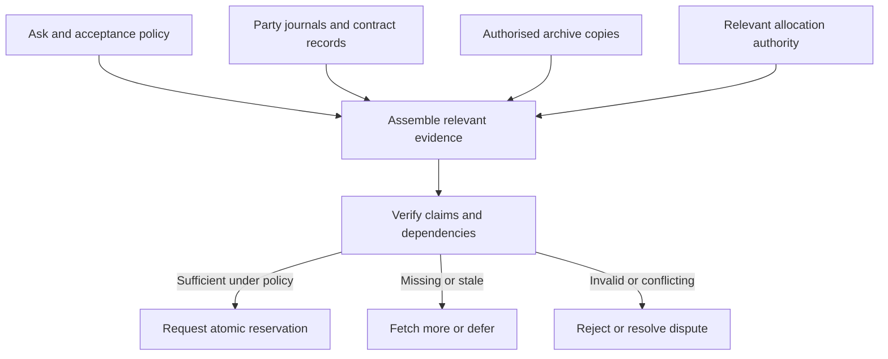

# Tidepool protocol sketch: local ledgers and evidence on demand

**Status:** proposed v0 architecture, 24 October 2026. This is a reviewable protocol sketch, not implemented software, a complete wire specification, or a proven consensus protocol. It extends the [trade case](../examples/distributed-trust-network-of-trade.md) and [network-health model](../examples/network-health-toy-model.md).

## 1. Answer and organising principle

No participant needs to hold the history of the entire network. Nodes retain their own obligations, share relevant contract evidence, and fetch additional evidence when deciding whether to accept a request. Hubs provide discovery and caches. A request is evaluated against a bounded, verified view assembled for that decision.

Use many scoped journals linked by content hashes. Their union forms a graph of evidence and dependencies. There is no universal block sequence, longest-chain rule, or requirement to merge every community into one ledger. Public material could still be collected by an archivist; the protocol does not guarantee that nobody can collect a large history.

Separate two functions:

- **Evidence:** offers, agreements, deliveries, tests, attestations, and disputes. Independent events can be recorded locally and reconciled later.
- **Allocation:** consuming a particular resource reservation, sponsored allowance, or shared budget. Conflicting claims require an agreed authority or agreement within the affected scope, or an explicitly accepted credit risk.

The proposed division follows the general lesson of coordination-avoidance research: whether concurrent operations are safe depends on the invariants they must preserve [coordination]. Research on Byzantine eventual consistency also applies to particular classes of operations, not every database or payment rule [bec]. This sketch does not claim those papers prove Tidepool secure.

## 2. Where records live

| Store | Contents | Responsible holders | Replication and checking |
| --- | --- | --- | --- |
| Node journals | The node's signed offers, reservations, commitments, observations, and key/control events, separated into declared scopes | Node controller and authorised backup providers | Retain required history; share signed events and checkpoint proofs selectively |
| Contract evidence | Exact terms, each party's acceptance, stage receipts, verification results, amendments, and dispute outcomes | Every party; relevant evaluator; contracted archive | Parties keep copies of the same signed objects; verify each signature and reference |
| Allocation ledger | Complete authoritative active state and recoverable history for one grant pool, shared budget, or reservation scope | That scope's named accounting service, or its configured replication group | Atomic allocation and duplicate rejection inside the scope; external clients receive scoped certificates |
| Directory/cache | Service advertisements, locations of records, supported protocols, and observed journal heads | Local hubs and optional cross-community indexes | Expiring hints; clients verify returned objects and issuer authority |
| Evidence archive | Encrypted retained objects and larger evidence blobs under a storage agreement | Chosen storage providers across specified failure domains | Retrieval audits, integrity checks, and repair; a stored hash alone is not a backup |

“Local” means scoped to the relevant actors or resource, not necessarily one geographic area. Peers can trade across hubs. A routing hub does not automatically become the accounting authority or adjudicator. Local preferences and endorsements confer no automatic authority outside their scope.

A first implementation can use a transactional embedded database for events, signatures, pinned heads, reservations, and derived views; large objects can live in a content-addressed file store. The event append, authoritative reservation change, and outgoing-message enqueue must commit together locally. Materialised search views can be rebuilt. No database product is mandated by this sketch.

## 3. Signed events and branches

An event has an immutable body, a content-derived identifier, and a signature by its author. Its body declares the journal, author, signing-key epoch, sequence, previous event in that author journal, event type, affected contract/scope, causal dependencies, and payload. Use a versioned canonical encoding, explicit integer units, domain-separated hashing/signing, and a standard library-backed cryptographic suite. The JSON below illustrates semantics only; placeholder hashes and signatures are not valid wire values.

```json
{
  "body": {
    "protocol": "tidepool-draft-0",
    "journal": "node-b/contract-42",
    "author": "did:web:node-b.example",
    "keyEpoch": 3,
    "sequence": 7,
    "previous": "sha256:previous-author-event",
    "kind": "storage.challenge.result",
    "contract": "sha256:agreed-contract-terms",
    "scope": "storage-contract-42",
    "dependsOn": ["sha256:requester-challenge"],
    "payload": {
      "stage": 4,
      "challengeNonce": "requester-fresh-nonce",
      "evidence": "sha256:retrieved-chunks-and-proofs"
    }
  },
  "eventId": "sha256:canonical-body-with-protocol-domain",
  "signature": "author-signature-over-domain-and-eventId"
}
```

Hash the canonical body without the event ID or signature to avoid a circular definition. Validate the signature using an authenticated key history. A response to a challenge records a provider claim; a separate acceptance event identifies the evaluator and verification method. A transport acknowledgement does not accept the service or settle the contract.

Each author journal is linear and append-only within its declared scope. A node may have separate journals for unrelated contracts and operating domains; those are ordinary branches. Contract evidence combines events from several authors through explicit references, yielding a causal DAG. Content-addressed DAGs are a familiar representation for immutable linked objects [merkle-dag].

Two incompatible signed continuations of the same author-journal position constitute equivocation. They are not two equally valid allocations to merge. Retain both as evidence and suspend the affected decision or invoke its resolver. Independent observations can coexist; contradictory promises or spends cannot be resolved by an arbitrary last-write-wins or longest-history rule. A new journal or key epoch must not silently erase prior obligations.

Concurrent writers belonging to one operator need coordinated sequencing, or explicitly separate delegated journals with bounded authority. Do not clone a controller's signing state onto two devices and assume their journals will safely merge.

## 4. Checkpoints, witnesses, and storage retention

Periodically commit each journal's ordered event identifiers to a Merkle tree and sign a checkpoint containing the journal ID, size, root, key epoch, and protocol version. This allows compact evidence of event inclusion and growth from an earlier accepted checkpoint. RFC 9162 describes these two proof types for transparency logs [transparency]. Its wire protocol is not adopted here.

A root verifies a commitment, not the truth, freshness, availability, or completeness of every relevant real-world claim. A malicious writer can present different views to different clients. Retained checkpoints and independent comparison make conflicting signed views detectable once evidence meets; gossip alone does not guarantee detection within a fixed time under partition.

Distinguish three acknowledgements:

- **Observed:** a witness saw a particular signed checkpoint.
- **Retained:** an archive accepted custody of specified objects until a stated deadline.
- **Validated:** an authorised evaluator checked named data or state transitions under a specified policy.

None implies the others. Merely counting witness signatures does not establish independent operation or consensus.

For an illustrative pilot, each party keeps active contract evidence and one independently operated archive retains an authorised copy through the contract's dispute and recovery window. Adjust replication for the required failure tolerance. Monitor and repair missing copies. Encrypt private evidence, retain keys and access grants separately, and define what a successor operator may recover.

Closed records can move out of hot storage after their retention obligations end. A checkpoint can support later integrity checking, but cannot reconstruct deleted evidence. Keep outstanding disputes, unspent grants, active reservations, key history needed for verification, and anti-replay state for every still-valid credential. Do not discard an authoritative spend record while it could permit a second redemption. Recovery snapshots need the same integrity, authority, retention, and rollback protections as the state they replace.

## 5. Discovery and selective synchronisation

Topology knowledge helps find providers and copies; it does not decide which claims are true. Maintain a bounded peer directory containing service types, endpoints, known failure dependencies, replica locations, and observed heads for subscribed scopes. Query local peers first, then other hubs or archives when needed. Use several independent routes for higher-risk evidence, rather than assuming one hub supplies a complete view.

Proposed message families:

| Message | Purpose | Required boundary |
| --- | --- | --- |
| `HELLO` / `ADVERTISE` | Negotiate versions, describe services and record locations | Advertisements expire; claimed capacity remains unproven |
| `ASK` / `QUOTE` | Describe the service, policy, price basis, time window, and evidence requirements | No resource is allocated by an advertisement or quote alone |
| `GET_HEAD` / `GET_EVENTS` / `GET_PROOF` | Fetch signed checkpoints, immutable objects, and proofs | Bound bytes, dependency depth, time, and permitted access |
| `STATUS` | Ask the authority about a scoped grant/reservation and current policy state | Bind the signed answer to the request nonce and accepted freshness conditions |
| `RESERVE` / `RESERVATION` | Atomically allocate a quantity for exact contract terms | Check the issuer, scope, audience, units, expiry, and current state |
| `ACCEPT` / `ACTIVATE` | Record exact agreement and activate valid reservations | Both parties' required confirmations must be observed before dependent delivery |
| `CHALLENGE` / `RESULT` / `RECEIPT` | Request evidence, provide it, and record its evaluation | Distinguish delivery, evaluation, and economic acceptance |
| `DISPUTE` / `RESOLVE` | Preserve conflicting claims and an authorised outcome | A new evaluator cannot unilaterally replace the agreed dispute policy |
| `HEADS` / `MISSING` | Compare subscribed histories and fetch missing objects | Receiving an object does not itself approve the represented action |

These are logical messages, not deployed endpoints. Start with authenticated direct HTTPS exchanges and reconnectable notifications. Optional store-and-forward transport must preserve signatures, confidentiality, replay protection, and access rules. Subscribe by contract, counterparty, or grant pool instead of consuming a full-network stream. Retry with bounded backoff; process duplicate delivery idempotently.

Peers compare observed heads and retrieve differences for subscribed journals. One peer being ahead is normal; unresolved missing events remain missing. An intermediary can omit an entire journal or suppress a dispute, so a quiet stream is not evidence of a clean history. Keep multiple evidence sources and explicit observation coverage.

## 6. Assemble the evidence required by an ask

The receiving node chooses an acceptance policy before evaluating candidates. For example: “Store two independently recoverable 2 GiB copies for 24 hours, within this funded allowance, with these retrieval requirements and acceptable operators.” The supplier cannot weaken that policy by choosing a convenient evidence bundle.

1. **Discover candidates.** Find offers and evidence locations through neighbours or hubs. Treat rankings and cached summaries as hints.
2. **Identify required claims.** List provider authority, precise terms, reservation/funding scope, relevant service evidence, independence assumptions, current key status, and unresolved contractual dependencies.
3. **Fetch objects by hash.** Retrieve terms, credentials, receipts, challenges, and relevant checkpoints from providers, counterparties, and archives. Reuse already verified immutable objects.
4. **Expand necessary dependencies.** Follow contract amendments, delegation chains, prior stages, and other references required by the policy. Stop only at an accepted trust anchor, independently verified state, or an explicitly accepted authority certificate. A signed checkpoint by an untrusted actor is not automatically a sufficient stopping point.
5. **Check integrity and meaning.** Verify hashes, signatures, authorisation, journal continuity/proofs as needed, replay identifiers, units, service-specific evidence, and allowed state transitions. Pin accepted checkpoints. Verify data access and retention obligations when the decision depends on future retrieval.
6. **Check current mutable state.** Obtain an authority response for still-valid allocations, revocations, or shared funding. A fresh nonce prevents reuse of an old reply; it does not make a dishonest authority truthful. Timestamp and freshness rules depend on the declared clock and authority assumptions.
7. **Decide, then reserve.** Successful read-only evaluation does not prevent a concurrent request consuming the same remaining allowance. Atomically obtain a contract-bound reservation from the responsible authority before treating the allocation as secured.

The resulting bundle lists its policy/version, root claims, objects, proof paths, accepted checkpoints/authorities, missing dependencies, and observation times. It is a view sufficient for a particular decision under particular assumptions, not a certificate that every participant has disclosed its entire history.



Return explicit statuses such as `SUPPORTED_AS_OF`, `INCOMPLETE`, `CONFLICT`, `INVALID`, or `ACCESS_DENIED`. Report the relevant anchors and policy with `SUPPORTED_AS_OF`. It is not a reservation or universal finality. When a required fetch exceeds the budget, defer, reduce the scope by explicit agreement, or seek another provider; do not silently omit a required check.

Positive evidence is often compact. Negative or aggregate claims are harder. “This task passed” may need one defined proof. “This provider has no defaults” or “98% of all jobs succeeded” needs justified coverage of a defined population and interval, including failures and a denominator. A supplier-selected set of successful receipts cannot establish either. Even a complete journal can omit real-world events never required to be registered; qualify the claim accordingly.

## 7. Local branches cannot multiply a shared allowance

Suppose a sponsor has a 10-unit pool. Branch West and branch East each see the same unspent 10 units and grant 8. Both local histories can have valid signatures, but their union has issued 16 units. A DAG, a hash, or eventual synchronisation does not repair that invariant after consumption.

For each such resource, choose one of three explicit models:

| Model | Safe operating rule | Partition behaviour |
| --- | --- | --- |
| Online scoped authority | A trusted service atomically tracks all allocations in its scope; later this could use a mature BFT protocol with specified membership/fault assumptions | Stop new allocations when the authority/agreement is unavailable |
| Disjoint delegated quotas | The parent reserves, for example, 6 units for West and 4 for East; each delegate enforces its own quota | Local issuance can continue within the reserved quota; safe enforcement still depends on the delegate or its replication group |
| Explicit bounded credit risk | A party knowingly delivers a limited amount without an enforceable exclusive allocation | Record and cap possible loss; do not label it double-spend prevention |

Quota transfers must debit or lock the source before crediting the destination, and old delegations must be fenced before reissue. Signed quota certificates alone do not stop a malicious delegate oversigning its portion. A recipient must accept the delegate's enforcement assumptions or require stronger scoped agreement. Recovery after partition cannot silently reset spend counters.

The pilot should use one known active accounting service per sponsored pool with durable state. Backups provide recovery, not permission for several replicas to independently issue against the same balance. Keep issuance halted after a crash until state and writer authority are safely recovered. BFT operation, membership changes, and automatic failover require a separately selected, reviewed protocol.

An allocation certificate binds the scope, grant or reservation ID, issuer/authority epoch, holder, permitted recipient or service, quantity and units, exact contract digest, validity, and monotonic state position. Redemption validates those fields and the authoritative current state, then records consumption atomically. A membership proof in an old “unspent” snapshot is insufficient.

Replicas responsible for a scope must retain enough complete state to enforce its invariants. Ordinary nodes need only the relevant certificates and evidence. This is how the system avoids a full-network ledger without pretending nobody must account for shared resources. Even correct reservation accounting does not prove an operator possesses the advertised physical disk, power, or bandwidth.

## 8. A complete small request

A asks B and C to retain two separately recoverable copies of a 2 GiB checkpoint for 24 hours. A sponsor funds four GiB-days of storage, represented using explicitly defined base units. B and C's common carrier or shared ownership would need to be assessed if independence is required.

A fetches the two offers, authorised service keys, exact verification terms, relevant previous evidence, and the sponsor's policy. It obtains current reservations from B and C's resource controllers and a sponsor allocation covering the agreed contracts. Each controller and sponsor account has an explicit trust model; no universal network balance is involved.

Each party signs acceptance of the precise terms. Reservations are provisional until activated under the contract protocol. Wait for all confirmations required by the affected stage before starting irreversible delivery. Define expiry, cancellation races, retries, and crash recovery; a bilateral exchange is not magically atomic across machines or physical services.

After upload, the requester retains the providers' receipts and verifies retrieval challenges. B's claim, A's acceptance, C's claim, and C's acceptance cross-reference the relevant contract and stages. The parties archive the evidence under the retention policy. The sponsor closes or settles only the authorised obligations according to the acceptance rules.

An unrelated node D later evaluating B can request this contract's permitted evidence and relevant authority history. D does not need C's unrelated work, every transaction through either hub, or the entire sponsor pool's history if D accepts the sponsor's state certification. If D does not trust that certification, it needs a stronger state proof or sufficient scope history to check the claim itself. That cost cannot be removed merely by calling the response a bundle.

## 9. Privacy, availability, and adversarial behaviour

| Situation | Protocol response |
| --- | --- |
| Hub returns altered records | Hash/signature checks reject them; try another source |
| Hub omits a failure or an entire journal | Do not infer absence; consult designated sources and disclose coverage limits |
| Author presents conflicting signed branches | Retain evidence, isolate the affected claim, and invoke policy; do not discard one silently |
| Required record exists only as a hash | Mark evidence unavailable until retrieved from a retained copy |
| Evidence is private | Request authorisation or an explicitly trusted attestation; denied access is not proof of fraud |
| Shared-budget authority is offline | Freeze dependent allocations; continue only preallocated or explicitly risk-bounded work |
| New key or restored old backup appears | Check authenticated continuity, revocation freshness, authority fencing, and outstanding obligations |
| Maliciously deep references or massive replies | Enforce size/depth/time limits and return incomplete rather than exhausting the node |
| Two private parties collude | Signed local claims gain no automatic external funding, independent-witness count, or wider reputation |

Private contracts should use encrypted transport and access-controlled storage. Publishing content hashes or dependencies can still reveal relationships; choose the public metadata deliberately, and use fresh random salts/commitments where needed to avoid revealing low-entropy private fields. A public commitment is not permission to read its payload.

Define maximum dependency depth, delegation length, object size, replication fanout, proof size, and query budget. Verification cost is proportional to the required evidence and the difficulty of its checks; neither is inherently constant. Accepted state checkpoints and narrow scopes reduce repeated work. Some requests will still be expensive or impossible under the chosen trust policy.

## 10. Fit with AT Protocol and implementation sequence

Use AT Protocol for discoverable identities, public offers, supported schema/version advertisements, and optional checkpoint/evidence-location publication. Public repository commits can authenticate the records presented [at-repo]. The core signed contract objects should remain verifiable independently of the publication host.

AT repositories are mutable and support record deletion; current exports are not Tidepool's permanent contract history. AT synchronisation can detect some missing updates within a followed repository, but an intermediary omitting an entire repository may not be detectable from that stream alone [at-sync]. Retain contractual evidence in the separate stores above. No AT relay or AppView is automatically a settlement authority or completeness oracle.

First implementation slice:

1. Versioned event and contract schemas, canonical encoding/signature suite, and deterministic verification rules.
2. Local event storage, per-author sequence/fork detection, staged contracts, and one durable sponsored-pool issuer.
3. Direct object retrieval with access control, bounded dependency traversal, and explicit incomplete/conflict statuses.
4. Party copies plus one archive, retention/recovery exercises, signed checkpoints, and proof verification.
5. A discovery adapter and selective synchronisation; subsequently evaluate delegated quotas or stronger scoped agreement.

Exercise an authentic partial history, selectively omitted failures, duplicated receipts, a writer fork, private evidence refusal, authority outage, restored stale state, and concurrent attempts to redeem the same allowance. Measure bytes and CPU per decision, evidence availability, scope-state size, query fanout, latency, and outstanding exposure. No runtime checks or performance results are claimed by this document.

## References

These sources inform the proposed design; none implements or validates the full Tidepool protocol. Retrieved 24 October 2026.

[coordination]: https://arxiv.org/abs/1402.2237
[bec]: https://arxiv.org/abs/2012.00472
[merkle-dag]: https://docs.ipfs.tech/concepts/merkle-dag/
[transparency]: https://www.rfc-editor.org/rfc/rfc9162.html
[at-repo]: https://atproto.com/specs/repository
[at-sync]: https://atproto.com/specs/sync

- Bailis et al., [Coordination Avoidance in Database Systems][coordination].
- Kleppmann and Howard, [Byzantine Eventual Consistency and the Fundamental Limits of Peer-to-Peer Databases][bec].
- IPFS documentation, [Merkle Directed Acyclic Graphs][merkle-dag].
- RFC 9162, [Certificate Transparency Version 2.0][transparency], especially inclusion/consistency proofs and inconsistent log views.
- AT Protocol, [Repository][at-repo] and [Sync][at-sync] specifications.
